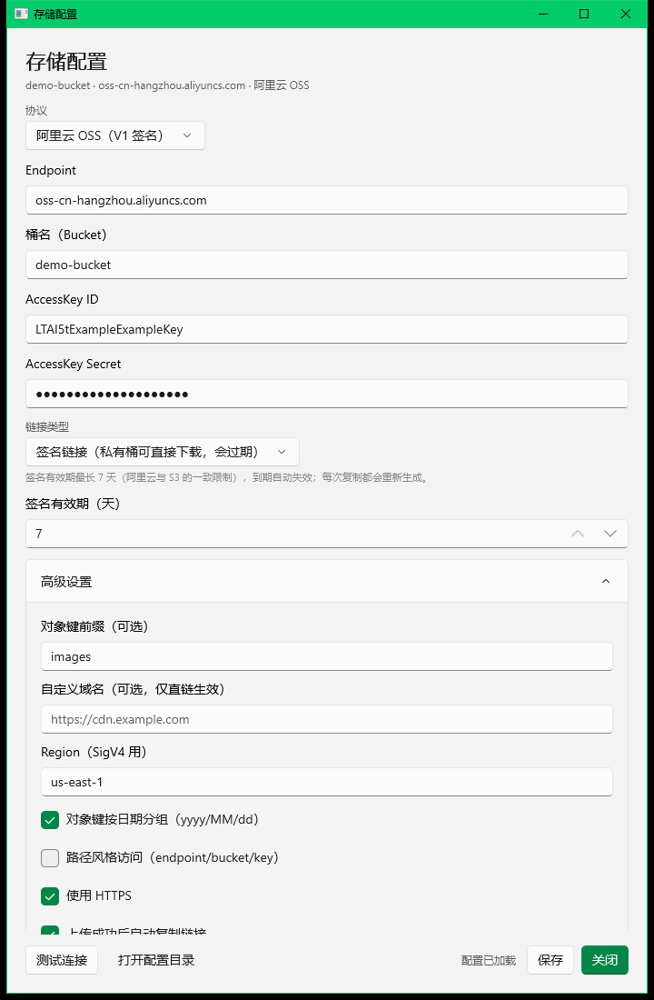

# OSS 拖拽上传

一个 Windows 桌面小工具：配好阿里云 OSS（或任意 S3 兼容服务）之后，**把文件拖进窗口就能上传，并直接拿到可访问的链接**。

界面完全用 [Microsoft.UI.Reactor](https://github.com/microsoft/microsoft-ui-reactor)（WinUI 3 上的声明式 C# UI 框架）写成：没有 XAML、没有 ViewModel、没有数据绑定 —— 一棵 `Element` 树 + `UseState` 状态钩子。


## 界面分工

主窗口只做三件事：**上传**、**看历史**、**复制链接**。存储配置在独立的设置窗口里。

| 主窗口 | 设置窗口（右上角「设置」） |
|---|---|
|  |  |

拖拽区域是一个虚线框：空闲时只显一条低调的描边，**鼠标移上去**就换成强调色描边 + 灰底（提示整块可点），文件拖进来时同样高亮并加粗、文案变成"松手即开始上传"，右上角小药丸显示当前目标桶。整块区域**都是点击热区**（没有单独的「选择文件」按钮），点一下任意位置就弹系统文件选择框，文案全部居中显示。


## 功能

- **拖拽即上传**：支持一次拖入多个文件；拖入文件夹会递归展开（最多 2000 个文件）。整块区域也是点击热区，点一下弹系统文件对话框，同样支持多选。
- **多个文件打包成 ZIP**：设置里打开后，一次拖入的内容展开后多于一个文件时，先打成一个 zip 再上传（拖文件夹不再刷出一长串记录）。zip 名字取第一个文件夹名，没有文件夹时叫「打包.zip」；只有一个文件时照常直传；打包用临时文件，传完/取消自动删除。
- **上传历史持久化**：成功的记录写进 `history.json`，重启后仍在，随时回来复制链接；列表按时间**倒序**（最新的在最上面），可按**文件名搜索**，也能直接点「下载」把对象存回本地（系统另存为对话框，默认原名 + 「下载」文件夹）；另有「复制全部链接」「移除」「清空记录」。
- **独立设置窗口**：改动立即生效、自动保存（400ms 防抖），底部还有「保存」按钮和「已保存 HH:mm:ss / 有未保存的更改…」状态提示；主窗口实时同步。设置页按「存储服务 → 上传与链接 → 启动与托盘」分成三张卡片，相关字段两列并排，常用项不再折叠进「高级设置」。
- **两个窗口共享一份配置**（单例状态 + 变更通知），不会出现"设置窗口里改了、主窗口还说不认识"的情况；关窗口时强制落盘。
- **两种签名协议**：阿里云 OSS 原生 V1 签名、AWS SigV4（MinIO / RustFS / 其他 S3 网关）。
- **桶自动创建**：第一次上传遇到 `NoSuchBucket` 会自动建桶并重试一次；「测试连接」也能建桶。
- **默认私有桶 + 预签名链接**：上传后生成带签名的下载链接（默认 7 天有效），私有桶也能直接点开；每次复制都会用当前配置重新签名。
- **对象键可配**：前缀 + `yyyy/MM/dd` 日期目录 + **防重名段**（`时分秒-随机8位`）+ 原文件名（文件夹拖入时保留相对子目录）。同一天重复上传同名文件不会互相覆盖；防重名段在文件名之前，所以 URL 最后一段始终是原始文件名，下载保存的名字不变。
- **链接形态可配**：虚拟主机 / 路径风格；直链模式支持自定义（CDN）域名与 `public-read` ACL。
- **简洁模式（圆形气泡）**：收成右下角一个圆，拖文件上去就传，环上显示进度，传完自动复制链接并短暂显示「已复制」。主窗口的「简洁模式」按钮或 `FileUploader.exe --compact` 都能进。
- **拖拽浮现（QQ 闪传式）**：平时完全隐形、不占位置；一开始拖文件，右下角就浮起一个半透明气泡，拖上去松手直接上传（拖的不是文件则立刻缩回），传完显示「已复制链接」后自动消失。
- **托盘常驻**：点关闭不再退出，而是收进托盘；左键/双击托盘图标恢复主窗口，右键菜单有「打开主窗口 / 简洁模式 / 设置 / 退出」，只有点「退出」才真正结束进程。
- **静默启动**：设置里打开「静默启动」后，双击 exe 不弹主窗口、只在托盘里待命（想用的时候点托盘图标叫回来）。还没配置存储、或把文件拖到 exe 上启动时仍会显示窗口，不会让人以为程序没启动。
- **开机自启**：设置里打开「开机自启」即写当前用户的启动项（任务管理器「启动」页可见、可关），不用管理员；和「静默启动」一起开就是开机直接进托盘。
- **检查更新（手动）**：设置页「关于与更新」里点一下，读 GitHub Release 的最新版本，列出「本次更新了哪些地方」；确认后自动下载 → 校验 SHA256 → 替换当前 exe → 重启。托盘右键菜单里也有「检查更新」。
- **并发 3 路上传**、实时进度、失败重试、取消。
- **命令行也能用**：`FileUploader.exe a.png b.txt "D:\照片"`（或把文件/文件夹拖到 exe 图标上）启动即上传；`FileUploader.exe --settings` 直接打开设置窗口。
- **配置可导出分发**：导出成 exe 同目录的 `FileUploader.export.bin`（AES-GCM 加密的二进制，不是可读文本），对方首次启动自动导入并自测连接，测通后自动删除该文件。

## 运行环境

- Windows 10 1809+ / Windows 11
- .NET 10 运行时（x64）。`dist/` 是自带 Windows App SDK 的构建产物，无需另外安装 Windows App Runtime

## 快速开始

```powershell
# 构建
dotnet build src\FileUploader.App\FileUploader.App.csproj -c Release

# 直接运行（调试）
dotnet run --project src\FileUploader.App

# 发布成可分发目录（dist\FileUploader.exe）
dotnet publish src\FileUploader.App\FileUploader.App.csproj -c Release -o dist
```

已生成好的发布产物：

| 目录 | 内容 | 适用 |
|---|---|---|
| `dist-portable\FileUploader.exe` | **单文件便携版**（≈89 MB，自带 .NET 10 运行时 + Windows App SDK） | 直接发给别人，拷过去双击就用 |
| `dist\` | 目录版（多文件，需要目标机器装 .NET 10 运行时） | 本机开发自用 |

单文件便携版生成命令（也可以用 `publish-portable.ps1`）：

```powershell
dotnet publish src\FileUploader.App\FileUploader.App.csproj -c Release -o dist-portable -r win-x64 `
  --self-contained true `
  -p:PublishSingleFile=true `
  -p:IncludeNativeLibrariesForSelfExtract=true `
  -p:EnableCompressionInSingleFile=true
```

## 便携版（发给别人用）

把 `dist-portable\FileUploader.exe` 单独一个文件拷给对方即可，目标机器**不需要装 .NET、也不需要装 Windows App Runtime**。

- 系统要求：Windows 10 1809+ / Windows 11，x64。
- 默认配置写在 `%APPDATA%\FileUploader`（多用户互不影响）。
- 想让配置跟着 exe 走：在 exe 同级目录放一个空的 **`portable.txt`**，配置与历史就写到 `data\settings.json`、`data\history.json`，整个文件夹拷到 U 盘也能带走。
- exe 没有代码签名，别人首次运行可能弹「Windows 已保护你的电脑」→ 点「更多信息 → 仍要运行」；正式分发建议自己签名。
- 放在有写权限的目录（桌面、D 盘、U 盘）；别放 `C:\Program Files` 下（便携模式的 data 目录需要可写）。
### 发给别人：导出配置 → 对方首次启动自动导入

因为密钥用 DPAPI 加密、换机器解不开，所以分发靠一个**导出文件**：

1. 自己机器上先配好、点「测试连接」确认可用。
2. 设置窗口点 **「导出配置」** → 在 exe 同目录生成 `FileUploader.export.bin`。
3. 把 `FileUploader.exe` + `FileUploader.export.bin` 放进同一个目录发给对方。
4. 对方双击 exe：
   - 自动导入配置并写入本机存储（密钥重新用 DPAPI 加密）；
   - 自动测一次连接（含建桶）；
   - **测通后才删除**同目录的导出文件；
   - 测不通则保留该文件、界面提示原因，修好后重新打开会再次导入。
5. 任何时候只要同目录还有导出文件，设置窗口顶部都会出现提示和 **「删除它」** 按钮。

导出文件的格式与强度：

| 项 | 说明 |
|---|---|
| 格式 | 二进制：`FUX1` 魔数 + 版本 + 12 字节 nonce + 16 字节 GCM tag + 密文；记事本/编辑器打开是乱码，不包含任何字段名或明文（只接受这一种格式，明文 JSON 会被拒绝） |
| 加密 | AES-256-GCM（认证加密，改一个字节都解不开），密钥由程序内置常量经 PBKDF2-SHA256 派生 |
| 强度定位 | **防窥不防逆向**：能挡住"双击打开看一眼"，挡不住有意的逆向分析。真要强保护，请用临时 AK + 最小权限，或分发后再改密钥 |
## 简洁模式（圆形气泡）

主窗口右上角点「简洁模式」，主窗口收起，右下角浮起一个 148px 的圆形气泡（带柔和阴影、始终置顶、不占任务栏）：

| 空闲 | 上传中 | 完成 |
|---|---|---|
|  |  |  |

- **拖文件到圆上**即上传（和主窗口共用同一条队列，主窗口的历史里也能看到）。
- 环上实时百分比；大文件在算 SHA-256 的几秒里显示「准备中」，不会一动不动。
- 传完自动复制链接（7 天签名链接），圆里短暂显示 ✓「已复制」。
- **单击圆**回到完整窗口；**右键**有「完整窗口 / 设置 / 退出」；按住圆可以拖动位置，窗口始终置顶、不占任务栏。拖动后的位置会记在 `bubble.json` 里，下次打开还在原处（只有气泡有一半以上跑到屏幕外时才回落到右下角）。
- 直接以气泡启动：`FileUploader.exe --compact`，也可以顺手带文件：`FileUploader.exe --compact "D:\a.png"`。
> **实现说明**：WinUI 3 没有逐像素透明窗口，这版 Windows App SDK 里也没有 `TransparentTintBackdrop`，
> 所以气泡不是 WinUI 窗口 —— 它是一个 `WS_EX_LAYERED` 原生窗口，用 GDI+ 画到 32 位预乘位图再
> `UpdateLayeredWindow`：圆、阴影、进度环、文字全是画出来的，文件拖放走 `WM_DROPFILES`。
> 主窗口隐藏/恢复用 Win32 `ShowWindow`（Reactor 会在挂载后把窗口显示出来，所以隐藏做了几次延迟收敛）。
## 拖拽浮现（QQ 闪传式）

不想开窗口、也不想常驻一个球的时候用这个：**平时完全看不见**——`alpha=1/255` 且带 `WS_EX_TRANSPARENT`，点击和拖拽全部穿透，不占位置、也不挡任何东西。

- 开始拖文件 → 右下角淡入一个半透明提示「拖到这里上传」（约 1.8 秒没下文就自己消失）。
- 把文件拖到它上面 → 变亮 + 「松手即上传 · n 个文件」，松手直接进入上传（和主窗口、简洁模式共用同一条队列）。
- 拖到别处松手 → 自动淡出，什么都不会发生。
- 从气泡上拖走（还没松手）→ 退回半透明提示继续亮着，方便再拖回来；直到这次拖拽结束才消失。
- 传完 → 「已复制链接」2.6 秒后淡出；没配置存储 → 显示「还没配置存储」，点一下直接进设置。
- 气泡贴在**鼠标所在显示器**的工作区右下角（工作区已排除任务栏）：启动时按当时光标所在屏摆放，**开始拖拽时还会再挪到光标所在那块屏**，多屏也不会拖了没反应。
- **可以在设置里关掉**：设置 → 启动与托盘 →「右下角拖拽浮现上传气泡」。关掉后不再创建那个隐形窗口、也不装拖拽探测器；改完立即生效，不用重启。
- 外观跟随系统浅色 / 深色主题：半透明表面 + 1px 发丝描边 + 一层很淡的投影；宽度按文案自适应，图标用和应用图标同一套「箭头 + 底线」线条。

```powershell
FileUploader.exe --flash-preview   # 开发用：依次演示 提示 → 可投放 → 上传中 → 完成
```

> **实现说明**：这不是 WinUI 窗口，而是一个 `WS_EX_LAYERED` 的原生窗口（独立 STA 线程 + 自己的消息循环 + `OleInitialize`）。
> 落点走 `RegisterDragDrop` 的 `IDropTarget` 而不是 `DragAcceptFiles`：只有前者能在 `DragEnter` 里用 `CF_HDROP`
> 判断「拖的是不是文件」，从而做到「拖上来才亮、不是文件立刻缩回」。
> 装睡时给窗口加 `WS_EX_TRANSPARENT`，鼠标消息和拖放落点搜索都会直接跳过它（实测：逐像素 alpha 的分层窗口在
> `WindowFromPoint` 里不走 `WM_NCHITTEST`，只有扩展样式这一层可靠）；只要有东西在显示、或者鼠标左键正按着，就摘掉这个样式。
> **「有人开始拖了」怎么判断**：系统的 `EVENT_SYSTEM_DRAGDROPSTART` 在 Win10 上实测对资源管理器的拖拽不触发，
> 低级鼠标钩子在拖拽期间又收不到回调（拖完松手才来第一个事件），所以改用「探针」：
> 按住左键拖出 6 像素后，把那个隐形窗口跟到光标下面（30ms 轮询，`SetWindowPos` 而已），
> 真实的 OLE 拖放会在它的 `DragEnter` 里露面 → 立刻把窗口收回右下角、亮起半透明提示。
> 拖选文字没有 OLE 拖放，所以**永远不会误报**；如果探针抓到的是非文件拖拽（拖文本、拖图片），
> 会立刻把窗口让开，绝不吞掉别人的落点。
> 落点区域比气泡本体向左上各多出 56×40 DIP，拖到气泡附近就能落；那块余量只在拖拽时接收落点，平时点不到。
## 托盘

- **关闭主窗口 = 收进托盘**（不会退出，上传队列继续跑）。托盘图标是运行时画的（蓝底白箭头），不依赖外部 `.ico`。
- **左键单击 / 双击**托盘图标：恢复主窗口。
- **右键**托盘图标：系统原生菜单（和资源管理器一致）——第一行灰显当前目标（`bucket · endpoint`），下面是 打开主窗口（默认项，粗体）/ 简洁模式 / 设置 / 退出。
- 只有菜单里的「退出」（或简洁模式气泡的右键→退出）才会真正结束进程。
- 托盘图标创建失败时会自动退回"关闭即退出"，不会出现窗口关掉又找不到程序的情况。

## 静默启动

设置 → **启动与托盘** → 打开「静默启动」，之后双击 exe（开机自启同理）**不弹主窗口**，只在托盘里待命；点托盘图标或右键→「打开主窗口」照常叫回来。改完保存，**下次启动生效**。

- 三种情况仍会显示主窗口，避免"双击了却什么都看不到"：**还没配置存储**（先让你看到配置引导）、**托盘图标创建失败**（没有托盘可退，关掉窗口就真的找不到了）、**命令行/拖到 exe 上带了文件**（要能看到上传进度）。
- 实现说明：Reactor 会在内容挂载后自己把窗口显示出来，所以静默启动是"挂载后立刻按 Win32 `ShowWindow(SW_HIDE)` 收掉、并补几次延迟收敛"；第一档补隐藏只等 60ms，实测窗口可见时间 < 20ms，基本看不到闪。

## 开机自启

设置 → **启动与托盘** → 打开「开机自启」，立刻生效（不用重启、不用管理员）：往 `HKCU\Software\Microsoft\Windows\CurrentVersion\Run` 写一条 `FileUploader`，值是带引号的 exe 全路径。

- 想让开机后直接进托盘：把「开机自启」和「静默启动」都打开。两个开关相互独立，只开自启的话登录后照常弹主窗口。
- 关掉开关就删掉那条启动项，`settings.json` 里的 `StartWithWindows` 同步落盘。
- **以注册表里的实际状态为准**：exe 换目录/改名后启动会按当前路径重写那条启动项；如果在任务管理器「启动」页把它禁用了（或被清理工具删掉），下次启动会发现启动项不在了，把设置里的开关**同步成关闭并提示**，不会偷偷加回来。
- 任务管理器 →「启动」页能看到这一项（名字就是 `FileUploader`）。
- 注册表写不进去（组策略、权限受限）时：设置页给红色提示，开关自动回滚，`crash.log` 里也留一条记录。
## 使用步骤

1. 点右上角 **「设置」**：
   - **协议**：阿里云 OSS 用「阿里云 OSS（V1 签名）」；MinIO / RustFS 等用「S3 兼容（SigV4）」。
   - **Endpoint**：`oss-cn-hangzhou.aliyuncs.com` 这种形式（带不带 `https://` 都行，不要带桶名）。
   - **桶名（Bucket）**、**AccessKey ID**、**AccessKey Secret**。
2. 点「测试连接」验证（桶不存在会自动创建）。
3. 回到主窗口，把文件拖到虚线区域，或者直接点一下这块区域（整块都能点，不用找按钮）。
4. 每行上传完成后会显示链接，默认自动复制到剪贴板；历史里随时可以再复制，也可以直接「下载」把文件存回本地。

### 设置项

| 选项 | 说明 |
|---|---|
| 协议 | OSS V1 签名 / S3 SigV4 |
| Endpoint | 区域 endpoint，不含桶名 |
| 桶名 | Bucket |
| AccessKey ID / Secret | 密钥，Secret 加密保存 |
| 对象键前缀 | 例如 `images`，最终键形如 `images/2026/11/16/143530-a1b2c3d4/a.png` |
| 链接类型 | 签名链接（私有桶，默认）/ 直链（需公共读） |
| 签名有效期（天） | 默认 7，**最长 7 天**（阿里云与 S3 一致限制），超出按 7 生成 |
| 自定义域名 | 仅直链模式生效，例如 `https://cdn.example.com`；签名链接始终用桶的 endpoint |
| Region | SigV4 签名用，S3 兼容服务一般 `us-east-1` 即可；阿里云 V1 签名不使用 |
| 路径风格访问 | `endpoint/bucket/key`（S3 兼容服务通常需要），阿里云默认关闭即 `bucket.endpoint/key` |
| 使用 HTTPS | 本地 http 服务（如 `127.0.0.1:9100`）请关闭 |
| 对象设为公共读 | 仅直链模式出现；上传时附带对象级 ACL |
| 自动复制链接 | 上传成功后写入剪贴板 |
| 多个文件打包成 ZIP 上传 | 一次拖入多于一个文件时先打成一个 zip 再传（见上一节）；单个文件仍直传 |
| 对象键按日期分组 | 打开了就是 `yyyy/MM/dd` 目录 |
| 静默启动 | 打开程序不弹主窗口、只留托盘（见上一节） |
| 开机自启 | 登录后自动启动（当前用户 Run 启动项，免管理员；和静默启动一起开＝开机进托盘） |
| 右下角拖拽浮现上传气泡 | 拖文件到屏幕右下角浮现上传气泡；关掉后不再创建隐形窗口 |

## 打包成 ZIP 上传

设置页「上传与链接」里的 **多个文件打包成 ZIP 上传**（默认关闭）。开着的时候：

| 拖入的内容 | 结果 |
|---|---|
| 1 个文件 | 直接上传那个文件（不打包，省一次没必要的压缩） |
| 1 个文件夹（里面 N>1 个文件） | 打成一个 `<文件夹名>.zip` 上传，列表里只有一条记录 |
| 多个文件夹 / 文件夹混着散文件 | 全部打成一个 zip（名字取第一个文件夹名）；都是散文件时叫 `打包.zip` |

要点：

- **压缩包结构**：顶层文件夹作为一级目录保留（拖 `照片` → 压缩包里是 `照片/…`），顶层散文件直接放根目录；空目录不会进包（zip 只存文件）。
- **已经压过的格式**（jpg/png/mp4/mp3/zip/docx/pdf 等）直接 stored 不再 deflate：一整文件夹手机照片再压一遍体积几乎不变，只会白烧几分钟 CPU。
- **列表里能看见进度**：开始打包就出现一行「打包中 xx%」，那一行也可以「取消」；打包失败（比如所有文件都读不到）会显示失败原因并且不再上传。
- **临时文件**：压缩包写在 `%TEMP%\FileUploader\<GUID>.zip`，上传成功、失败、取消、手动移除都会删掉；打包期间临时目录需要大约等于源体积的空闲空间（测试用的 600 个文件 / 58.6 MB → zip 61.5 MB）。
- 打包只用 .NET 自带的 `System.IO.Compression`，没有新增依赖；读取时用共享读方式打开源文件，正在被别的程序写日志也能读；读不到的文件会被跳过并在提示条里说明。

## 检查更新（手动）

设置页最下面的「关于与更新」卡片，或者托盘右键菜单里的「检查更新」。

- **数据来源**：`https://api.github.com/repos/qianshipoi/FileUploader/releases/latest`（匿名，未登录每小时 60 次，够用）。读的是最新 **正式版**，draft/预发布不会推给你。
- **「更新了哪些地方」**：直接取 Release 说明里 `### 本次变更（上一个 tag..本次 tag）` 那一节的列表项（发版流水线自动生成的提交清单），最多显示 20 条，多的给个链接。没有这一节时提示去发布页看。
- **更新流程**：下载 `FileUploader-<版本>-win-x64.exe` → **校验 SHA256**（用 Release 资产自带的 `digest`，没有就退回说明里的 `SHA256 (...)` 行）→ 复制成 `FileUploader.new.exe` → 当前 exe 改名成 `.old` → 新的顶到正式名 → 启动新进程 → 本进程退出。任何一步失败都会把 `.old` 改回去并给出原因，不会留下一个没有 exe 的目录；`.old` 会在下次启动时自动删掉。
- **安全边界**：正在上传/打包时不允许更新（会提示等传完），替换前会先把配置落盘。配置和历史在 `%APPDATA%`（或便携目录 `data/`）里，更新只换 exe，不动数据。
- 下载缓存在 `%TEMP%\FileUploader\update-<版本>\`，校验失败的文件会立刻删掉。

引用块：为什么不用后台自动检查？这是有意的 —— 工具本身不需要联网常驻，只在你想查的时候查一次，也不用在后台偷偷发请求。

## 链接类型

| 模式 | 行为 | 适用 |
|---|---|---|
| **签名链接**（默认） | 上传时对象保持私有，链接里带 `Signature`（OSS V1）或 `X-Amz-Signature`（SigV4），到期自动失效；默认 **7 天** | 私有桶，最常用 |
| 直链 | 不带签名，只有桶/对象公共读时才能打开；可配自定义域名 | 公共读桶 / CDN |

要点：

- 签名链接**每次复制都会重新生成**，所以历史里存的旧链接过期了也不影响，点「复制链接」拿到的永远是新的 7 天。也正因为如此，**历史列表不再显示签名地址**（显示出来反而像是一个长期有效的链接）——只有直链模式下才在列表里展示地址。
- 签名有效期上限 **7 天**（阿里云与 S3 SigV4 都按 7 天封顶），设置大于 7 天会自动按 7 天生成。
- 直链模式下的「对象设为公共读」只对 OSS 这类遵守对象 ACL 的服务有效；MinIO / RustFS 只认桶策略。

需要的 RAM 最小权限（阿里云 OSS，仅上传 + 生成签名链接）：

```json
{
  "Version": "1",
  "Statement": [
    { "Effect": "Allow", "Action": ["oss:PutObject"], "Resource": ["acs:oss:*:*:my-bucket/*"] },
    { "Effect": "Allow", "Action": ["oss:GetBucketInfo", "oss:ListObjects"], "Resource": ["acs:oss:*:*:my-bucket"] }
  ]
}
```

（`oss:PutBucket` 只在自动建桶时需要。）

## 上传历史（搜索与下载）

主窗口下半部分是历史列表，按**时间倒序**排（最近上传的在最上面），最多保留 200 条。

- **按文件名搜索**：列表上方的搜索框边输入边过滤，不区分大小写，只匹配文件名（不匹配对象键里的日期目录与前缀）。标题旁会显示 `命中 / 总数`，右侧的「复制全部链接」只复制**当前筛选出来的**那些；搜索时「清空记录」会禁用，避免把看不见的记录一起删掉。点「清除」或搜索框里的 × 回到全部记录。
- **下载**：每行一个「下载」按钮 → 系统「另存为」对话框（默认文件名取原始文件名，默认位置是「下载」文件夹）→ 流式写入你选的位置，按钮上显示百分比、行内显示进度条，完成后提示保存路径。下载走的链接是**用当前配置现签**的（见 `ObjectUrlBuilder.DownloadUrl`），所以私有桶、历史里存的旧签名过期了都照样能下；下载失败（403 过期 / 404 对象已被删）会删掉对话框建出来的空文件并给出原因。
- 一次只下载一个：进度条只有一个位置显示，所以下载期间其它行的「下载」按钮会暂时禁用。

## 数据文件

| 文件 | 内容 |
|---|---|
| `%APPDATA%\FileUploader\settings.json` | 配置；`Secret` 字段是 Windows DPAPI（当前用户）加密后的 Base64（便携模式下为 `exe目录\data\settings.json`） |
| `%APPDATA%\FileUploader\history.json` | 最近 200 条上传记录（便携模式同样在 `data\` 下） |
| `%TEMP%\FileUploader\<GUID>.zip` | 「打包成 ZIP 上传」用的临时压缩包；上传成功/失败/取消/移除后自动删除 |
| `%TEMP%\FileUploader\update-<版本>\` | 检查更新下载到的新版 exe（校验通过才会拿去替换；校验失败立即删除） |

设置窗口底部有「打开配置目录」可直接定位。密钥换机器/换账户无法解密，程序会提示重填。

## 本地用 Docker + RustFS 验证

不花钱、不碰真实 OSS 也能跑通整条链路：

```powershell
docker run -d --name fu-rustfs -p 9100:9000 -p 9101:9001 `
  -v ${PWD}\.testdata\rustfs:/data `
  -e RUSTFS_ACCESS_KEY=testadmin -e RUSTFS_SECRET_KEY=testadmin123 `
  rustfs/rustfs:latest
```

设置窗口里填：协议 `S3 兼容（SigV4）`、Endpoint `127.0.0.1:9100`、桶 `demo`、AK `testadmin`、SK `testadmin123`，取消「使用 HTTPS」（路径风格保持勾选）。

命令行验证签名与上传：

```powershell
# 离线签名向量 + 配置加解密自测
dotnet run --project tools\FileUploader.Verify

# 真实上传一次，并打印生成的链接
$env:FU_ENDPOINT='127.0.0.1:9100'; $env:FU_BUCKET='demo'
$env:FU_AK='testadmin'; $env:FU_SK='testadmin123'
$env:FU_PROTOCOL='s3'; $env:FU_PATHSYLE='true'; $env:FU_HTTPS='false'
dotnet run --project tools\FileUploader.Verify -- upload
```

## 项目结构

```
src/FileUploader.Core/              与 UI 无关的存储层
  AppSettings.cs                    配置模型与校验
  AppPaths.cs                       配置/历史目录（%APPDATA% 或便携模式 exe\data）
  SettingsStore.cs                  settings.json 读写（密钥 DPAPI 加密）
  HistoryStore.cs                   history.json（最近 200 条）
  ZipPackager.cs                    多个文件打成一个 zip（进度 / 跳过坏文件 / 命名）
  UpdateChecker.cs                  检查更新：读 GitHub Release / 版本比较 / 提取「本次变更」/ SHA256
  ObjectKey.cs                      对象键构造 + RFC 3986 编码
  Storage/ObjectUrlBuilder.cs       直链 / 预签名链接（OSS V1、SigV4）+ 下载用地址
  ContentTypes.cs                   扩展名 → Content-Type
  Storage/Signers.cs                OSS V1 / SigV4 签名
  Storage/ObjectStorageClient.cs    PUT Object、HEAD/PUT Bucket、进度上报、错误解析
  Storage/ObjectDownloader.cs       GET 流式下载到本地文件（进度 / 临时文件 / 错误说明）
  Storage/StorageHttp.cs            上传与下载共用的 HttpClient
src/FileUploader.App/               WinUI 3 + Reactor 界面
  App.cs                            入口（文件参数、--settings）
  UploadApp.cs                      主窗口：头部、提示条、布局、跨窗口状态订阅
  UploadApp.DropZone.cs             拖拽区域（整块点击选题 + DragEnter/Over/Leave/Drop）
  UploadApp.UploadList.cs           上传历史列表（文件名搜索 / 下载 / 复制 / 重试 / 移除 / 清空）
  NativeBubbleWindow.cs             简洁模式：分层窗口 + GDI+ 绘制的圆形气泡
  FlashDropWindow.cs                拖拽浮现：隐形分层窗口 + 落点 + 淡入淡出状态机
  DropTargetInterop.cs              IDropTarget / CF_HDROP 互操作（拖放数据里取文件路径）
  DragWatcher.cs                    拖拽开始/结束探测（系统拖拽事件 + 低级鼠标钩子兜底）
  DragFlashController.cs            拖拽浮现气泡的装配与开关
  UploadQueue.cs                    全局上传队列（主窗口与气泡共用）
  AppWindows.cs                     窗口切换：主窗口 / 设置 / 气泡 / 托盘图标与菜单
  UploadApp.Uploading.cs            上传队列（并发 3、进度、取消、历史落盘）
  SettingsWindow.cs                 独立的设置窗口（存储 + 启动行为）
  StartupRegistration.cs            开机自启（HKCU Run 启动项：写入 / 删除 / 启动时校正）
  AppVersion.cs                     当前版本号（来自 csproj 的 <Version>，发版时由 tag 覆盖）
  Updater.cs                        自更新：下载 + SHA256 校验 + 替换 exe + 重启 + 失败回滚
  SettingsState.cs                  跨窗口共享配置（INotifyPropertyChanged + 防抖落盘）
  DropExpander.cs                   拖入项 → 文件列表（文件夹递归；有路径时走 System.IO 快路径）
  UploadModels.cs                   上传条目 / 提示条模型
tools/FileUploader.Verify/          签名 / 上传 / 预签名链接 / 下载自测
tools/OssSdkCompare/                与阿里云官方 SDK 对比签名（回归用）
tools/capture.ps1                   截图小工具（调试用）
tools/uia-settings.ps1              设置窗口的 UI 自动化脚本（回归验证用）
tools/uia-history-search.ps1        历史记录搜索与「下载」保存对话框的 UI 自动化回归
tools/tray-activate-test.ps1       托盘激活回归：窗口被别的窗口压住时点托盘要能叫到前台
tools/update-e2e-test.ps1          检查更新与自更新回归：本机假 feed → 真下载 → 真替换 → 真重启
tools/flash-drop-test.ps1           拖拽浮现气泡回归（位置 / 命中穿透 / 落点注册 / 设置开关 / 拖选文字）
tools/real-drag-onto-bubble.ps1     真实拖拽验证（资源管理器拖文件到气泡，ESC 取消不上传）
docs/                               截图
```

## 已验证

- OSS V1 `StringToSign` 与官方文档示例逐字符一致；SigV4 `Authorization` 与 AWS 官方 GET Object 示例签名完全一致（`tools/FileUploader.Verify` 的 `vectors` 用例全绿）。
- **预签名链接与阿里云官方 SDK 逐字段一致**：同一 AK/SK/有效期下，本项目生成的 `Signature` 与 `Aliyun.OSS.SDK.NetCore` 的 `GeneratePresignedUri` 完全相同（`tools/OssSdkCompare`）。
- 预签名链接实测（RustFS）：签名链接 GET → 200 且内容一致；同一对象的直链 GET → 403（对象确实是私有的）；把签名时间拨到 8 天前 → 403（过期失效）。
- UI 生成的签名链接直接可用：界面上传两个文件后，用历史里的链接匿名 GET → 200 / 1900 字节、200 / 29 字节。
- 对本机 Docker RustFS 端到端：拖入两个文件（含中文名/中文内容）→ `NoSuchBucket` 自动建桶并重试 → 上传成功 → 落盘字节与源文件逐字节一致。
- 历史持久化：关掉程序重开，两条记录与链接仍在（截图即重启后的界面）。
- 设置窗口用 UI 自动化（`tools/uia-settings.ps1`）实测过完整编辑链路：文本/密码/下拉/勾选都能保存到 `settings.json`，重开窗口回读正常，不点「保存」时 400ms 后也会自动落盘并显示「已保存 HH:mm:ss」。
- 失败态：网络不可达时红色提示条 + 行内错误 + 「重试/移除」。
- 整块点击热区实测：在拖拽区中心点一下，只弹 1 个系统文件对话框（`_isPicking` 连点保护），取消后无异常提示且不产生上传记录。
- 简洁模式反复进出 4 次（每次新建/销毁原生气泡窗口）进程稳定，无 `crash.log`；气泡窗口意外消失时主窗口会自动恢复。
- 拖拽浮现气泡（`tools/flash-drop-test.ps1`）：窗口贴在右下角工作区、预览显示期间可命中自己、装睡时点击穿透到下层窗口、`RegisterDragDrop` 返回 0、无 `crash.log`。
- 设置窗口与主窗口共享同一份配置：任一侧修改，另一侧即时刷新；密钥 DPAPI 加解密往返、落盘无明文。
- 新设置页布局用 UI 自动化验证过（`tools/uia-settings.ps1`，窗口标题改为「设置」）：Endpoint / 桶名 / AccessKey ID 按标题找到、协议下拉、HTTPS 与「静默启动」开关都能点，保存后 `settings.json` 里 `StartSilently` 为 `true`。
- 「静默启动」四种启动路径实测（便携模式，不碰真实配置）：开着 + 已配置 → 主窗口 `IsWindowVisible=False` 且进程存活；关掉 → 主窗口可见；开着但没配置 → 主窗口可见；开着且命令行带文件 → 主窗口可见。20ms 采样下窗口可见仅 1 帧（≈20ms），没有明显闪烁。
- 「开机自启」实测（便携副本，测完已删掉启动项）：UIA 打开开关 → `HKCU\...\Run` 出现 `FileUploader`，值是带引号的 exe 全路径且配置同步为 `true`；再点一下 → 启动项消失、配置回到 `false`；把启动项改指一条旧路径后重启 → 按当前 exe 重写、配置保持 `true`；直接把启动项删掉后重启 → 配置同步成 `false` 且不会偷偷加回来；其余 7 个用户启动项全程未被动过。
- 历史列表**倒序 + 按文件名搜索**用 UI 自动化实测（`tools/uia-history-search.ps1`，便携副本里放 4 条记录）：关键字「报告」只剩 1 行；`SCREEN` 这种大写关键字也能命中 `screenshot-settings.png`（不区分大小写）；无匹配时显示「0 / 4 条匹配」且一行都不留；点「清除」后搜索框清空、4 行全部回来。
- 「下载」端到端实测（便携副本 + 本机 HTTP 服务冒充对象存储，不碰真实桶）：点「下载」→ 系统「另存为」对话框弹出（文件名已填原名、位置在「下载」、类型 `原文件类型 (*.txt)`）→ 确认后文件落到 `Downloads\local-download.txt`，大小 37 B 与内容（含中文）逐字节一致，提示条显示保存路径；点「取消」则窗口关闭且不产生任何文件。
- `ObjectDownloader` 离线回归（`FileUploader.Verify download`，本机 TcpListener 冒充存储）：200 内容逐字节一致、进度回调到最终字节数、临时 `.part` 不残留；403/404 给出可读原因且不落文件；无效链接直接失败；取消抛 `OperationCanceledException`。
- 下载地址选择（`FileUploader.Verify presign`）：配置齐全时一律现签（直链模式也一样，私有桶才下得动），未配置时退回历史里的旧链接，两者都没有时返回空（界面提示先去配置）。
- 打包这一步用 `FileUploader.Verify zip` 离线自测（真文件 → 真 zip → 读回来比对）：压缩包内路径 `A/sub/b.txt`、内容逐字节一致、已压缩扩展名走得是 stored（压缩前后等长）、读不到的文件被跳过并计数、进度逐个上报、取消抛 `OperationCanceledException` 且不留半成品、全部读不到时报失败且不留文件。
- 「多个文件打包成 ZIP 上传」端到端实测（便携副本 + 本机假存储，不碰真实桶）：拖入 `季度资料`（3 个文件含中文名/中文内容）→ 只发一次 `PUT`，服务端收到的 `季度资料.zip` 里是 `季度资料/a.txt`、`季度资料/c.jpg`、`季度资料/子目录/b.txt`，内容逐字节一致；历史里只有 1 条记录；`%TEMP%\FileUploader` 里没有残留。
- 600 个文件 / 58.6 MB 的文件夹：只发一次 `PUT`（62 MB 的 zip，600 个条目），临时 zip 传完即删；打包中途点「取消」（UIA 在「打包中 25%」时点）→ 行变「已取消」、没有 PUT、没有历史、没有残留临时文件。
- 回归确认默认行为没变：关掉开关后，同一个文件夹仍是 3 个文件各自上传 3 次 `PUT`。
- 单个文件不打包：`FileUploader.exe a.txt` 直接上传 `a.txt`；两个散文件 → 一个 `打包.zip`（里面 `a.txt` / `b.txt` 在根目录）。
- 设置页开关用 UIA 实测（`tools/uia-settings.ps1 -ToggleZip`）：切换后 `settings.json` 里的 `ZipBatchUpload` 随之翻转（True → False），关窗口时自动落盘。
- 顺带修掉一个真实卡顿：拖入 600 个文件的文件夹时，WinRT 逐个 `GetBasicPropertiesAsync` 读大小要 ≈55 秒（拖进去像卡死）；改成有真实路径时走 `System.IO` 快路径后，同一文件夹 2.0 秒就出现「打包中」那一行。
- 修掉「窗口压在别的窗口下面时，点/双击托盘没反应」：根因是点托盘图标时用户输入是发给 shell 的，系统不认为本进程拿到最后一次输入，`SetForegroundWindow` 被前台锁定规则**静默拒绝**（实测返回 `false`：窗口一动不动，用「临时置顶再取消」也还是 `false`）。现在的做法是 `AttachThreadInput` 挂到当前前台线程 → `BringWindowToTop` → `SetForegroundWindow`（实测 `true`），最小化时先 `SW_RESTORE`；万一还是没拿到前台就写一条 `crash.log`（含两个 hwnd），不再静默失败。
- 托盘激活的回归脚本 `tools/tray-activate-test.ps1`（`--bring-preview` 触发和点托盘完全相同的那条路径）：记事本当遮挡物 → 断言本程序窗口可见但不是前台 → 触发 → 断言前台变成 `OSS 拖拽上传`。**同一脚本在「注释掉修复」的构建上会 FAIL**（前台仍是记事本），说明它真的抓得住这个 bug。
- 检查更新的离线自测（`FileUploader.Verify update`，26 项）：版本比较（v 前缀、同版本、预发布、`beta.10 > beta.9` 的字典序陷阱、非法版本号）、从 Release 说明里只抽「本次变更」那一节、SHA256 按资产名优先匹配、解析真实形状的 release JSON（选中 win-x64 exe、`digest` 归一化成小写、`size`、发布页链接）。
- 检查更新的**真实网络**实测：便携副本（版本 0.2.0）→ UIA 点「检查更新」→ 打 `api.github.com` 拿到最新 release `v0.2.0` → 显示「已经是最新版本（0.2.0）」。
- 自更新端到端（`tools/update-e2e-test.ps1`，本机假 feed + 假新版 exe，不碰真实 GitHub）：界面列出「发现新版本 9.9.9」和两条变更 → **摘要故意给错时拒绝替换并提示「校验失败…已丢弃，没有替换任何文件」**（exe 哈希不变）→ 换成正确摘要后真下载、真替换：旧进程退出、新进程起来、磁盘上的 exe SHA256 与 feed 一致、没有留下 `.new` 中间文件、缓存在 `%TEMP%\FileUploader\update-9.9.9\`，重启后 `.old` 被自动清理且程序正常运行。
- `dotnet build`（Debug/Release）与 `dotnet publish` 均无警告无错误。

## 排查闪退

程序会把未处理异常写到 `%APPDATA%\FileUploader\crash.log`（含完整堆栈）；简洁模式的原生窗口若创建失败，主窗口也会自动回来，不会留下"窗口没了、托盘也没了"的僵局。托盘图标点不回来（前台激活被系统拒绝）时也会在这里留一条记录，便于区分"没触发"和"触发了但没抢到前台"。

## 发版（GitHub Release，全自动）

推一个 `v` 开头的 tag，GitHub Actions 就会在 Windows runner 上打包**单文件便携版**并发布到 Release：

```powershell
git tag v0.1.0            # 版本号自定，tag 形如 v1.2.3 / v1.2.3-beta.1
git push origin v0.1.0    # 推送 tag 即触发
```

- 流水线：`.github/workflows/release.yml`（tag 触发；也可在 Actions 页面手动输入 tag 重发，已存在的 Release 会覆盖上传）。
- 产物：`FileUploader-<版本>-win-x64.exe`（≈89 MB，自带 .NET 10 运行时 + Windows App SDK）与同名 `.zip`。
- Release 说明自动带上下载表格、SHA256 校验值和「上一个 tag → 本次 tag」的提交清单；tag 带 `-` 的（如 `v1.2.3-beta.1`）自动标为 pre-release。
- **版本号要两边一致**：程序里的版本来自 `src/FileUploader.App/FileUploader.App.csproj` 的 `<Version>`（发版流水线会用 `-p:Version=<tag>` 覆盖成 tag 的版本）。所以打 tag 前把 csproj 的 `<Version>` 也改成同一个号，这样本地构建的版本号、Release 的 tag、检查更新的比较三者才对得上。
- 日常提交/PR 只跑 `.github/workflows/ci.yml`（编译 + 签名自测），不发版。

## 已知限制

- 只实现单次 `PUT Object`（简单上传），没有分片/断点续传；阿里云 OSS 与 S3 简单上传上限均为 5 GB。
- 「打包成 ZIP 上传」是一次拖入打一个包（不会按子文件夹拆包），打包期间 `%TEMP%` 需要约等于源体积的空闲空间；而且**只打包文件**，空目录不会进包。
- 检查更新要能访问 `api.github.com`：墙内/公司网络可能需要系统代理或 `HTTPS_PROXY`。连不上时设置页只给一行错误提示，不影响其它功能。
- 自更新只替换**当前目录里的 exe**：如果程序装在 `Program Files` 这类需要管理员权限的目录，替换会失败并提示手动下载；也可以直接用 `-win-x64.exe` 便携版替换。
- 签名链接最长 7 天（阿里云与 S3 SigV4 一致限制），更长的链接需要自己做 CDN + 私有鉴权。
- 只支持 Windows；界面文字为中文。
- Reactor 目前是 preview 版（`0.1.0-preview.16`），升级小版本时分析器可能给出新的建议警告。
