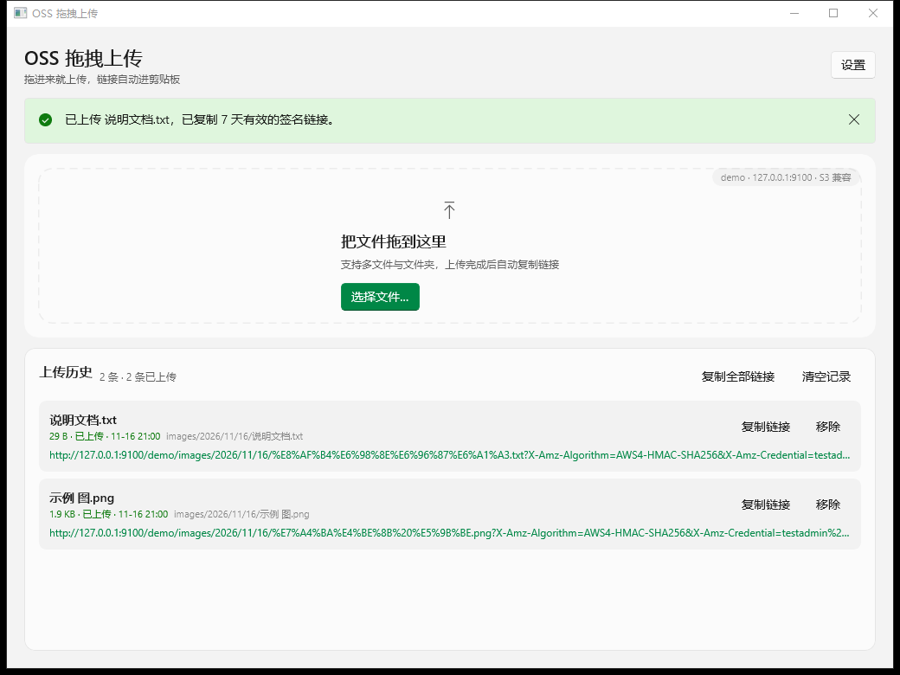
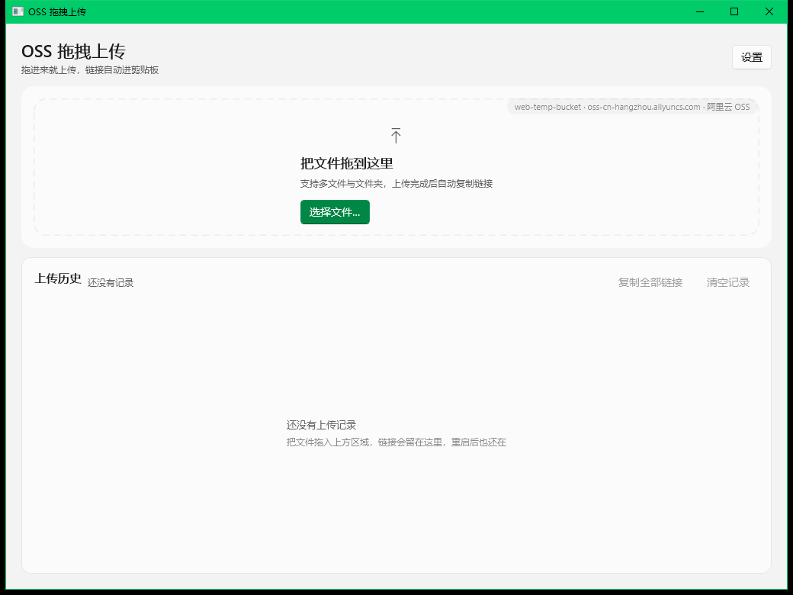
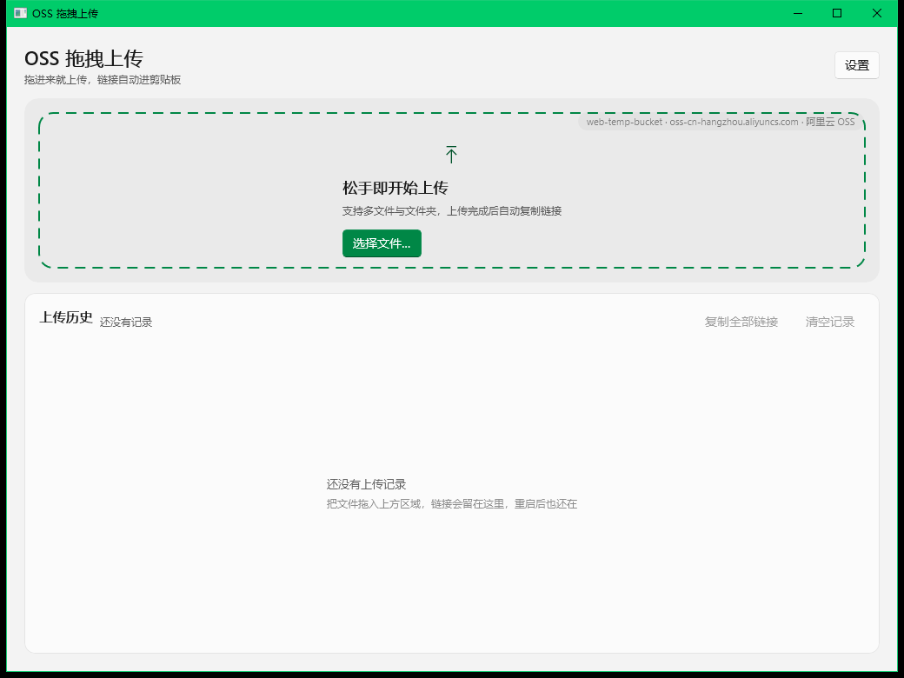
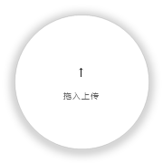

# OSS 拖拽上传

一个 Windows 桌面小工具：配好阿里云 OSS（或任意 S3 兼容服务）之后，**把文件拖进窗口就能上传，并直接拿到可访问的链接**。

界面完全用 [Microsoft.UI.Reactor](https://github.com/microsoft/microsoft-ui-reactor)（WinUI 3 上的声明式 C# UI 框架）写成：没有 XAML、没有 ViewModel、没有数据绑定 —— 一棵 `Element` 树 + `UseState` 状态钩子。



## 界面分工

主窗口只做三件事：**上传**、**看历史**、**复制链接**。存储配置在独立的设置窗口里。

| 主窗口 | 设置窗口（右上角「设置」） |
|---|---|
|  |  |

拖拽区域是一个虚线框：空闲时只显一条低调的描边，文件拖进来会变成强调色 + 灰底、文案变成"松手即开始上传"，右上角小药丸显示当前目标桶。


## 功能

- **拖拽即上传**：支持一次拖入多个文件；拖入文件夹会递归展开（最多 2000 个文件）。「选择文件…」用系统文件对话框，同样支持多选。
- **上传历史持久化**：成功的记录写进 `history.json`，重启后仍在，随时回来复制链接；支持「复制全部链接」「移除」「清空记录」。
- **独立设置窗口**：改动立即生效、自动保存（400ms 防抖），底部还有「保存」按钮和「已保存 HH:mm:ss / 有未保存的更改…」状态提示；主窗口实时同步。
- **两个窗口共享一份配置**（单例状态 + 变更通知），不会出现"设置窗口里改了、主窗口还说不认识"的情况；关窗口时强制落盘。
- **两种签名协议**：阿里云 OSS 原生 V1 签名、AWS SigV4（MinIO / RustFS / 其他 S3 网关）。
- **桶自动创建**：第一次上传遇到 `NoSuchBucket` 会自动建桶并重试一次；「测试连接」也能建桶。
- **默认私有桶 + 预签名链接**：上传后生成带签名的下载链接（默认 7 天有效），私有桶也能直接点开；每次复制都会用当前配置重新签名。
- **对象键可配**：前缀 + `yyyy/MM/dd` 日期目录 + 原文件名（文件夹拖入时保留相对子目录）。
- **链接形态可配**：虚拟主机 / 路径风格；直链模式支持自定义（CDN）域名与 `public-read` ACL。
- **简洁模式（圆形气泡）**：收成右下角一个圆，拖文件上去就传，环上显示进度，传完自动复制链接并短暂显示「已复制」。主窗口的「简洁模式」按钮或 `FileUploader.exe --compact` 都能进。
- **托盘常驻**：点关闭不再退出，而是收进托盘；左键/双击托盘图标恢复主窗口，右键菜单有「打开主窗口 / 简洁模式 / 设置 / 退出」，只有点「退出」才真正结束进程。
- **并发 3 路上传**、实时进度、失败重试、取消。
- **命令行也能用**：`FileUploader.exe a.png b.txt`（或把文件拖到 exe 图标上）启动即上传；`FileUploader.exe --settings` 直接打开设置窗口。
- **配置可导出分发**：导出成 exe 同目录的 `FileUploader.export.bin`（AES-GCM 加密的二进制，不是可读文本），对方首次启动自动导入并自测连接，测通后自动删除该文件。

## 运行环境

- Windows 10 1809+ / Windows 11
- .NET 10 运行时（x64）。`dist/` 是自带 Windows App SDK 的构建产物，无需另外安装 Windows App Runtime

## 快速开始

```powershell
# 构建
dotnet build src\FileUploader.App\FileUploader.App.csproj -c Release

# 直接运行（调试）
dotnet run --project src\FileUploader.App

# 发布成可分发目录（dist\FileUploader.exe）
dotnet publish src\FileUploader.App\FileUploader.App.csproj -c Release -o dist
```

已生成好的发布产物：

| 目录 | 内容 | 适用 |
|---|---|---|
| `dist-portable\FileUploader.exe` | **单文件便携版**（≈89 MB，自带 .NET 10 运行时 + Windows App SDK） | 直接发给别人，拷过去双击就用 |
| `dist\` | 目录版（多文件，需要目标机器装 .NET 10 运行时） | 本机开发自用 |

单文件便携版生成命令（也可以用 `publish-portable.ps1`）：

```powershell
dotnet publish src\FileUploader.App\FileUploader.App.csproj -c Release -o dist-portable -r win-x64 `
  --self-contained true `
  -p:PublishSingleFile=true `
  -p:IncludeNativeLibrariesForSelfExtract=true `
  -p:EnableCompressionInSingleFile=true
```

## 便携版（发给别人用）

把 `dist-portable\FileUploader.exe` 单独一个文件拷给对方即可，目标机器**不需要装 .NET、也不需要装 Windows App Runtime**。

- 系统要求：Windows 10 1809+ / Windows 11，x64。
- 默认配置写在 `%APPDATA%\FileUploader`（多用户互不影响）。
- 想让配置跟着 exe 走：在 exe 同级目录放一个空的 **`portable.txt`**，配置与历史就写到 `data\settings.json`、`data\history.json`，整个文件夹拷到 U 盘也能带走。
- exe 没有代码签名，别人首次运行可能弹「Windows 已保护你的电脑」→ 点「更多信息 → 仍要运行」；正式分发建议自己签名。
- 放在有写权限的目录（桌面、D 盘、U 盘）；别放 `C:\Program Files` 下（便携模式的 data 目录需要可写）。
### 发给别人：导出配置 → 对方首次启动自动导入

因为密钥用 DPAPI 加密、换机器解不开，所以分发靠一个**导出文件**：

1. 自己机器上先配好、点「测试连接」确认可用。
2. 设置窗口点 **「导出配置」** → 在 exe 同目录生成 `FileUploader.export.bin`。
3. 把 `FileUploader.exe` + `FileUploader.export.bin` 放进同一个目录发给对方。
4. 对方双击 exe：
   - 自动导入配置并写入本机存储（密钥重新用 DPAPI 加密）；
   - 自动测一次连接（含建桶）；
   - **测通后才删除**同目录的导出文件；
   - 测不通则保留该文件、界面提示原因，修好后重新打开会再次导入。
5. 任何时候只要同目录还有导出文件，设置窗口顶部都会出现提示和 **「删除它」** 按钮。

导出文件的格式与强度：

| 项 | 说明 |
|---|---|
| 格式 | 二进制：`FUX1` 魔数 + 版本 + 12 字节 nonce + 16 字节 GCM tag + 密文；记事本/编辑器打开是乱码，不包含任何字段名或明文（只接受这一种格式，明文 JSON 会被拒绝） |
| 加密 | AES-256-GCM（认证加密，改一个字节都解不开），密钥由程序内置常量经 PBKDF2-SHA256 派生 |
| 强度定位 | **防窥不防逆向**：能挡住"双击打开看一眼"，挡不住有意的逆向分析。真要强保护，请用临时 AK + 最小权限，或分发后再改密钥 |
## 简洁模式（圆形气泡）

主窗口右上角点「简洁模式」，主窗口收起，右下角浮起一个 148px 的圆形气泡（带柔和阴影、始终置顶、不占任务栏）：

| 空闲 | 上传中 | 完成 |
|---|---|---|
|  |  |  |

- **拖文件到圆上**即上传（和主窗口共用同一条队列，主窗口的历史里也能看到）。
- 环上实时百分比；大文件在算 SHA-256 的几秒里显示「准备中」，不会一动不动。
- 传完自动复制链接（7 天签名链接），圆里短暂显示 ✓「已复制」。
- **单击圆**回到完整窗口；**右键**有「完整窗口 / 设置 / 退出」；按住圆可以拖动位置，窗口始终置顶、不占任务栏。
- 直接以气泡启动：`FileUploader.exe --compact`，也可以顺手带文件：`FileUploader.exe --compact "D:\a.png"`。
> **实现说明**：WinUI 3 没有逐像素透明窗口，这版 Windows App SDK 里也没有 `TransparentTintBackdrop`，
> 所以气泡不是 WinUI 窗口 —— 它是一个 `WS_EX_LAYERED` 原生窗口，用 GDI+ 画到 32 位预乘位图再
> `UpdateLayeredWindow`：圆、阴影、进度环、文字全是画出来的，文件拖放走 `WM_DROPFILES`。
> 主窗口隐藏/恢复用 Win32 `ShowWindow`（Reactor 会在挂载后把窗口显示出来，所以隐藏做了几次延迟收敛）。
## 托盘

- **关闭主窗口 = 收进托盘**（不会退出，上传队列继续跑）。托盘图标是运行时画的（蓝底白箭头），不依赖外部 `.ico`。
- **左键单击 / 双击**托盘图标：恢复主窗口。
- **右键**托盘图标：系统原生菜单（和资源管理器一致）——第一行灰显当前目标（`bucket · endpoint`），下面是 打开主窗口（默认项，粗体）/ 简洁模式 / 设置 / 退出。
- 只有菜单里的「退出」（或简洁模式气泡的右键→退出）才会真正结束进程。
- 托盘图标创建失败时会自动退回"关闭即退出"，不会出现窗口关掉又找不到程序的情况。
## 使用步骤

1. 点右上角 **「设置」**：
   - **协议**：阿里云 OSS 用「阿里云 OSS（V1 签名）」；MinIO / RustFS 等用「S3 兼容（SigV4）」。
   - **Endpoint**：`oss-cn-hangzhou.aliyuncs.com` 这种形式（带不带 `https://` 都行，不要带桶名）。
   - **桶名（Bucket）**、**AccessKey ID**、**AccessKey Secret**。
2. 点「测试连接」验证（桶不存在会自动创建）。
3. 回到主窗口，把文件拖到虚线区域（或点「选择文件…」）。
4. 每行上传完成后会显示链接，默认自动复制到剪贴板；历史里随时可以再复制。

### 设置项

| 选项 | 说明 |
|---|---|
| 协议 | OSS V1 签名 / S3 SigV4 |
| Endpoint | 区域 endpoint，不含桶名 |
| 桶名 | Bucket |
| AccessKey ID / Secret | 密钥，Secret 加密保存 |
| 对象键前缀 | 例如 `images`，最终键形如 `images/2026/11/16/a.png` |
| 链接类型 | 签名链接（私有桶，默认）/ 直链（需公共读） |
| 签名有效期（天） | 默认 7，**最长 7 天**（阿里云与 S3 一致限制），超出按 7 生成 |
| 自定义域名 | 仅直链模式生效，例如 `https://cdn.example.com`；签名链接始终用桶的 endpoint |
| Region | SigV4 签名用，S3 兼容服务一般 `us-east-1` 即可；阿里云 V1 签名不使用 |
| 路径风格访问 | `endpoint/bucket/key`（S3 兼容服务通常需要），阿里云默认关闭即 `bucket.endpoint/key` |
| 使用 HTTPS | 本地 http 服务（如 `127.0.0.1:9100`）请关闭 |
| 对象设为公共读 | 仅直链模式出现；上传时附带对象级 ACL |
| 自动复制链接 | 上传成功后写入剪贴板 |

## 链接类型

| 模式 | 行为 | 适用 |
|---|---|---|
| **签名链接**（默认） | 上传时对象保持私有，链接里带 `Signature`（OSS V1）或 `X-Amz-Signature`（SigV4），到期自动失效；默认 **7 天** | 私有桶，最常用 |
| 直链 | 不带签名，只有桶/对象公共读时才能打开；可配自定义域名 | 公共读桶 / CDN |

要点：

- 签名链接**每次复制都会重新生成**，所以历史里存的旧链接过期了也不影响，点「复制链接」拿到的永远是新的 7 天。
- 签名有效期上限 **7 天**（阿里云与 S3 SigV4 都按 7 天封顶），设置大于 7 天会自动按 7 天生成。
- 直链模式下的「对象设为公共读」只对 OSS 这类遵守对象 ACL 的服务有效；MinIO / RustFS 只认桶策略。

需要的 RAM 最小权限（阿里云 OSS，仅上传 + 生成签名链接）：

```json
{
  "Version": "1",
  "Statement": [
    { "Effect": "Allow", "Action": ["oss:PutObject"], "Resource": ["acs:oss:*:*:my-bucket/*"] },
    { "Effect": "Allow", "Action": ["oss:GetBucketInfo", "oss:ListObjects"], "Resource": ["acs:oss:*:*:my-bucket"] }
  ]
}
```

（`oss:PutBucket` 只在自动建桶时需要。）

## 数据文件

| 文件 | 内容 |
|---|---|
| `%APPDATA%\FileUploader\settings.json` | 配置；`Secret` 字段是 Windows DPAPI（当前用户）加密后的 Base64（便携模式下为 `exe目录\data\settings.json`） |
| `%APPDATA%\FileUploader\history.json` | 最近 200 条上传记录（便携模式同样在 `data\` 下） |

设置窗口底部有「打开配置目录」可直接定位。密钥换机器/换账户无法解密，程序会提示重填。

## 本地用 Docker + RustFS 验证

不花钱、不碰真实 OSS 也能跑通整条链路：

```powershell
docker run -d --name fu-rustfs -p 9100:9000 -p 9101:9001 `
  -v ${PWD}\.testdata\rustfs:/data `
  -e RUSTFS_ACCESS_KEY=testadmin -e RUSTFS_SECRET_KEY=testadmin123 `
  rustfs/rustfs:latest
```

设置窗口里填：协议 `S3 兼容（SigV4）`、Endpoint `127.0.0.1:9100`、桶 `demo`、AK `testadmin`、SK `testadmin123`，取消「使用 HTTPS」（路径风格保持勾选）。

命令行验证签名与上传：

```powershell
# 离线签名向量 + 配置加解密自测
dotnet run --project tools\FileUploader.Verify

# 真实上传一次，并打印生成的链接
$env:FU_ENDPOINT='127.0.0.1:9100'; $env:FU_BUCKET='demo'
$env:FU_AK='testadmin'; $env:FU_SK='testadmin123'
$env:FU_PROTOCOL='s3'; $env:FU_PATHSYLE='true'; $env:FU_HTTPS='false'
dotnet run --project tools\FileUploader.Verify -- upload
```

## 项目结构

```
src/FileUploader.Core/              与 UI 无关的存储层
  AppSettings.cs                    配置模型与校验
  AppPaths.cs                       配置/历史目录（%APPDATA% 或便携模式 exe\data）
  SettingsStore.cs                  settings.json 读写（密钥 DPAPI 加密）
  HistoryStore.cs                   history.json（最近 200 条）
  ObjectKey.cs                      对象键构造 + RFC 3986 编码
  Storage/ObjectUrlBuilder.cs       直链 / 预签名链接（OSS V1、SigV4）
  ContentTypes.cs                   扩展名 → Content-Type
  Storage/Signers.cs                OSS V1 / SigV4 签名
  Storage/ObjectStorageClient.cs    PUT Object、HEAD/PUT Bucket、进度上报、错误解析
src/FileUploader.App/               WinUI 3 + Reactor 界面
  App.cs                            入口（文件参数、--settings）
  UploadApp.cs                      主窗口：头部、提示条、布局、跨窗口状态订阅
  UploadApp.DropZone.cs             拖拽区域（DragEnter/Over/Leave/Drop）
  UploadApp.UploadList.cs           上传历史列表（复制 / 重试 / 移除 / 清空）
  NativeBubbleWindow.cs             简洁模式：分层窗口 + GDI+ 绘制的圆形气泡
  UploadQueue.cs                    全局上传队列（主窗口与气泡共用）
  AppWindows.cs                     窗口切换：主窗口 / 设置 / 气泡 / 托盘图标与菜单
  UploadApp.Uploading.cs            上传队列（并发 3、进度、取消、历史落盘）
  SettingsWindow.cs                 独立的存储配置窗口
  SettingsState.cs                  跨窗口共享配置（INotifyPropertyChanged + 防抖落盘）
  DropExpander.cs                   拖入项 → 文件列表（文件夹递归）
  UploadModels.cs                   上传条目 / 提示条模型
tools/FileUploader.Verify/          签名 / 上传 / 预签名链接自测
tools/OssSdkCompare/                与阿里云官方 SDK 对比签名（回归用）
tools/capture.ps1                   截图小工具（调试用）
tools/uia-settings.ps1              设置窗口的 UI 自动化脚本（回归验证用）
docs/                               截图
```

## 已验证

- OSS V1 `StringToSign` 与官方文档示例逐字符一致；SigV4 `Authorization` 与 AWS 官方 GET Object 示例签名完全一致（`tools/FileUploader.Verify` 的 `vectors` 用例全绿）。
- **预签名链接与阿里云官方 SDK 逐字段一致**：同一 AK/SK/有效期下，本项目生成的 `Signature` 与 `Aliyun.OSS.SDK.NetCore` 的 `GeneratePresignedUri` 完全相同（`tools/OssSdkCompare`）。
- 预签名链接实测（RustFS）：签名链接 GET → 200 且内容一致；同一对象的直链 GET → 403（对象确实是私有的）；把签名时间拨到 8 天前 → 403（过期失效）。
- UI 生成的签名链接直接可用：界面上传两个文件后，用历史里的链接匿名 GET → 200 / 1900 字节、200 / 29 字节。
- 对本机 Docker RustFS 端到端：拖入两个文件（含中文名/中文内容）→ `NoSuchBucket` 自动建桶并重试 → 上传成功 → 落盘字节与源文件逐字节一致。
- 历史持久化：关掉程序重开，两条记录与链接仍在（截图即重启后的界面）。
- 设置窗口用 UI 自动化（`tools/uia-settings.ps1`）实测过完整编辑链路：文本/密码/下拉/勾选都能保存到 `settings.json`，重开窗口回读正常，不点「保存」时 400ms 后也会自动落盘并显示「已保存 HH:mm:ss」。
- 失败态：网络不可达时红色提示条 + 行内错误 + 「重试/移除」。
- 「选择文件…」用 UI 自动化连点验证：只弹 1 个系统对话框，取消后无异常提示且不产生上传记录（连点保护）。
- 简洁模式反复进出 4 次（每次新建/销毁原生气泡窗口）进程稳定，无 `crash.log`；气泡窗口意外消失时主窗口会自动恢复。
- 设置窗口与主窗口共享同一份配置：任一侧修改，另一侧即时刷新；密钥 DPAPI 加解密往返、落盘无明文。
- `dotnet build`（Debug/Release）与 `dotnet publish` 均无警告无错误。

## 排查闪退

程序会把未处理异常写到 `%APPDATA%\FileUploader\crash.log`（含完整堆栈）；简洁模式的原生窗口若创建失败，主窗口也会自动回来，不会留下"窗口没了、托盘也没了"的僵局。

## 发版（GitHub Release，全自动）

推一个 `v` 开头的 tag，GitHub Actions 就会在 Windows runner 上打包**单文件便携版**并发布到 Release：

```powershell
git tag v0.1.0            # 版本号自定，tag 形如 v1.2.3 / v1.2.3-beta.1
git push origin v0.1.0    # 推送 tag 即触发
```

- 流水线：`.github/workflows/release.yml`（tag 触发；也可在 Actions 页面手动输入 tag 重发，已存在的 Release 会覆盖上传）。
- 产物：`FileUploader-<版本>-win-x64.exe`（≈89 MB，自带 .NET 10 运行时 + Windows App SDK）与同名 `.zip`。
- Release 说明自动带上下载表格、SHA256 校验值和「上一个 tag → 本次 tag」的提交清单；tag 带 `-` 的（如 `v1.2.3-beta.1`）自动标为 pre-release。
- 日常提交/PR 只跑 `.github/workflows/ci.yml`（编译 + 签名自测），不发版。

## 已知限制

- 只实现单次 `PUT Object`（简单上传），没有分片/断点续传；阿里云 OSS 与 S3 简单上传上限均为 5 GB。
- 签名链接最长 7 天（阿里云与 S3 SigV4 一致限制），更长的链接需要自己做 CDN + 私有鉴权。
- 只支持 Windows；界面文字为中文。
- Reactor 目前是 preview 版（`0.1.0-preview.16`），升级小版本时分析器可能给出新的建议警告。
