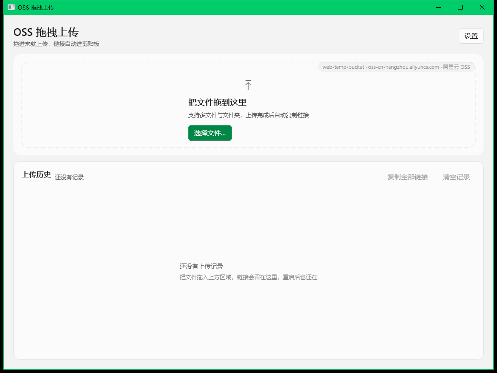
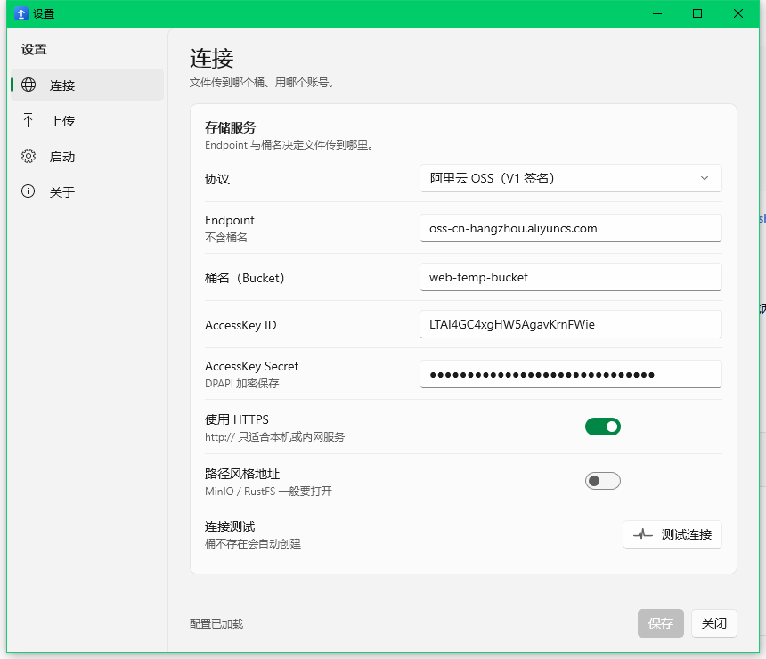
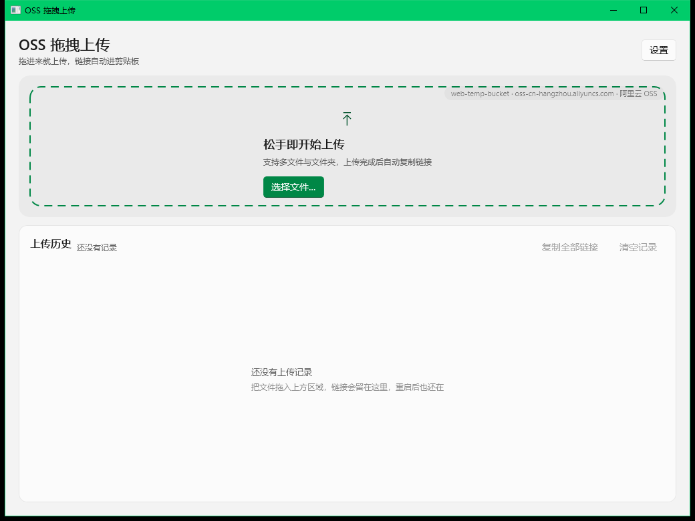
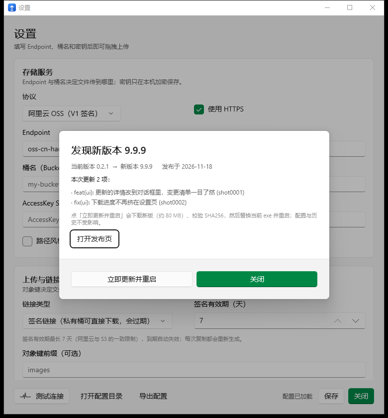

# 使用手册

面向使用者的完整说明。概览见 [README](../README.md)。

## 界面分工

主窗口只做三件事：**上传**、**看历史**、**复制链接**。存储配置在独立的设置窗口里。

| 主窗口 | 设置窗口（右上角「设置」） |
|---|---|
|  |  |

拖拽区域是一个虚线框：空闲时只显一条低调的描边，**鼠标移上去**就换成强调色描边 + 灰底（提示整块可点），文件拖进来时同样高亮并加粗、文案变成「松手即开始上传」，右上角小药丸显示当前目标桶。整块区域**都是点击热区**（没有单独的「选择文件」按钮），点一下任意位置就弹系统文件选择框，文案全部居中显示。



## 使用步骤

1. 点右上角 **「设置」**：
   - **协议**：阿里云 OSS 用「阿里云 OSS（V1 签名）」；MinIO / RustFS 等用「S3 兼容（SigV4）」。
   - **Endpoint**：`oss-cn-hangzhou.aliyuncs.com` 这种形式（带不带 `https://` 都行，不要带桶名）。
   - **桶名（Bucket）**、**AccessKey ID**、**AccessKey Secret**。
2. 点「测试连接」验证（桶不存在会自动创建）。
3. 回到主窗口，把文件拖到虚线区域，或者直接点一下这块区域（整块都能点，不用找按钮）。
4. 每行上传完成后会显示链接，默认自动复制到剪贴板；历史里随时可以再复制，也可以直接「下载」把文件存回本地。

## 设置项

设置窗口左边是**四个分类**，右边只放这一类的东西，一页一屏不用翻：

| 分类 | 放什么 |
|---|---|
| 连接 | 协议、Endpoint、桶名、Region、AK/SK、HTTPS、路径风格、测试连接 |
| 上传 | 对象键前缀、按日期分组、链接类型与有效期、自定义域名、自动复制链接、打包 ZIP、公共读 |
| 启动 | 静默启动、开机自启、右下角拖拽浮现 |
| 关于 | 版本与检查更新、配置文件位置、打开配置目录 / 导出配置 |

**保存时机分两类**（底部一行会写清楚当前状态）：

- **开关和下拉框**（「静默启动」「按日期分组」「链接类型」……）：选了就生效、立刻写进 `settings.json`，没有"确定"这一步。
- **输入框**（Endpoint、桶名、AK/SK、Region、前缀、域名、有效期）：改的是草稿，**点「保存」才落盘**。底部会提示「有输入还没保存」，不做修改时「保存」是灰的。
- 带着没保存的输入点「关闭」或窗口右上角的 ×：会先问一句 **保存并关闭 / 不保存 / 取消**。选「取消」窗口留着、草稿也还在；选「不保存」只丢掉这次的输入，已经点过的开关不受影响。
- 为什么不再逐字符自动保存：输入过程中主窗口可能正要上传，读到一个写了一半的 Endpoint 只会让人莫名失败；而且多数时候你只是点开看看。

各选项含义：

| 选项 | 说明 |
|---|---|
| 协议 | OSS V1 签名 / S3 SigV4 |
| Endpoint | 区域 endpoint，不含桶名 |
| 桶名 | Bucket |
| AccessKey ID / Secret | 密钥，Secret 加密保存 |
| 对象键前缀 | 例如 `images`，最终键形如 `images/2026/11/16/143530-a1b2c3d4/a.png`（设置页里有实时示例） |
| 链接类型 | 签名链接（私有桶，默认）/ 直链（需公共读） |
| 签名有效期（天） | 默认 7，**最长 7 天**（阿里云与 S3 一致限制），超出按 7 生成 |
| 自定义域名 | 仅直链模式生效，例如 `https://cdn.example.com`；签名链接始终用桶的 endpoint |
| Region | SigV4 签名用，S3 兼容服务一般 `us-east-1` 即可；阿里云 V1 签名不使用 |
| 路径风格访问 | `endpoint/bucket/key`（S3 兼容服务通常需要），阿里云默认关闭即 `bucket.endpoint/key` |
| 使用 HTTPS | 本地 http 服务（如 `127.0.0.1:9100`）请关闭 |
| 对象设为公共读 | 仅直链模式出现；上传时附带对象级 ACL |
| 自动复制链接 | 上传成功后写入剪贴板 |
| 多个文件打包成 ZIP 上传 | 一次拖入多于一个文件时先打成一个 zip 再传（见下文），单个文件仍直传 |
| 对象键按日期分组 | 打开了就是 `yyyy/MM/dd` 目录 |
| 静默启动 | 打开程序不弹主窗口、只留托盘（见下文） |
| 开机自启 | 登录后自动启动（当前用户 Run 启动项，免管理员；和静默启动一起开＝开机进托盘） |
| 右下角拖拽浮现上传气泡 | 拖文件到屏幕右下角浮现上传气泡；关掉后不再创建隐形窗口 |

## 大文件分片上传与断点续传

**不用任何设置**：文件达到 8 MiB 就自动走分片上传（8 MiB 一片，文件特别大时自动放大分片，保证不超过 10000 片），小文件仍然一次性 `PUT`（少三次往返、更快）。两种协议都支持，对象键、链接类型、公共读设置全部照旧。

分片上传带来的最大好处是**中断不用从头再来**：

| 场景 | 行为 |
|---|---|
| 网络中断 / 服务端报错 | 每片失败会自动重试 3 次（网络抖动、5xx、限流），仍失败则整条记录变「失败」，**已传的分片留在服务端** |
| 上传中点了「取消」 | 记录变「已取消」，已传的分片保留；点「重试」从断点继续 |
| 传一半关掉程序 / 程序崩了 | 进度写在 `%APPDATA%\FileUploader\uploads`（便携模式在 `data\uploads`）；下次打开，列表里会多出一条 **「已中断 · 已传 xx%」**，点 **「继续」** 接着传 |
| 想彻底放弃这个文件 | 点「移除」或「清空记录」：本地进度和**服务端已收的分片**一起删掉，不会在桶里留看不见的垃圾 |

要点：

- **续传一定沿用同一个对象键**（URL 里那串带时间的目录不会变），所以续传出来的文件和一次传完的完全等价；对象键没有变、也没有多出一个新对象。
- 判定"还能续传"看三件事：同一个存储配置（Endpoint / 桶 / 协议）、同一个对象键、同一个本地文件（路径 + 大小 + 最后修改时间）。**文件被改过、换过桶、或换了机器，就只能重新传**。
- 中断的记录在列表里带进度条和「继续」按钮，已经传了多少一目了然。
- 长期没动过的续传记录（超过 7 天）会在启动时自动清掉，并顺手让服务端放弃那些分片。
- 想自己看进度：`uploads\*.json` 里记着 uploadId、分片大小和每片的 ETag（不含密钥）。

## 上传历史（搜索与下载）

主窗口下半部分是历史列表，按**时间倒序**排（最近上传的在最上面），最多保留 200 条。

- **按文件名搜索**：列表上方的搜索框边输入边过滤，不区分大小写，只匹配文件名（不匹配对象键里的日期目录与前缀）。标题旁会显示 `命中 / 总数`，右侧的「复制全部链接」只复制**当前筛选出来的**那些；搜索时「清空记录」会禁用，避免把看不见的记录一起删掉。点「清除」或搜索框里的 × 回到全部记录。
- **下载**：每行一个「下载」按钮 → 系统「另存为」对话框（默认文件名取原始文件名，默认位置是「下载」文件夹）→ 流式写入你选的位置，按钮上显示百分比、行内显示进度条，完成后提示保存路径。下载走的链接是**用当前配置现签**的（见 `ObjectUrlBuilder.DownloadUrl`），所以私有桶、历史里存的旧签名过期了都照样能下；下载失败（403 过期 / 404 对象已被删）会删掉对话框建出来的空文件并给出原因。
- 一次只下载一个：进度条只有一个位置显示，所以下载期间其它行的「下载」按钮会暂时禁用。

## 打包成 ZIP 上传

设置页 **上传** → 「链接与上传」里的 **多个文件打包成 ZIP 上传**（默认关闭）。开着的时候：

| 拖入的内容 | 结果 |
|---|---|
| 1 个文件 | 直接上传那个文件（不打包，省一次没必要的压缩） |
| 1 个文件夹（里面 N>1 个文件） | 打成一个 `<文件夹名>.zip` 上传，列表里只有一条记录 |
| 多个文件夹 / 文件夹混着散文件 | 全部打成一个 zip（名字取第一个文件夹名）；都是散文件时叫 `打包.zip` |

要点：

- **压缩包结构**：顶层文件夹作为一级目录保留（拖 `照片` → 压缩包里是 `照片/…`），顶层散文件直接放根目录；空目录不会进包（zip 只存文件）。
- **已经压过的格式**（jpg/png/mp4/mp3/zip/docx/pdf 等）直接 stored 不再 deflate：一整文件夹手机照片再压一遍体积几乎不变，只会白烧几分钟 CPU。
- **列表里能看见进度**：开始打包就出现一行「打包中 xx%」，那一行也可以「取消」；打包失败（比如所有文件都读不到）会显示失败原因并且不再上传。
- **临时文件**：压缩包写在 `%TEMP%\FileUploader\<GUID>.zip`，上传成功、失败、取消、手动移除都会删掉；打包期间临时目录需要大约等于源体积的空闲空间（测试用的 600 个文件 / 58.6 MB → zip 61.5 MB）。
- 打包只用 .NET 自带的 `System.IO.Compression`，没有新增依赖；读取时用共享读方式打开源文件，正在被别的程序写日志也能读；读不到的文件会被跳过并在提示条里说明。

## 链接类型

| 模式 | 行为 | 适用 |
|---|---|---|
| **签名链接**（默认） | 上传时对象保持私有，链接里带 `Signature`（OSS V1）或 `X-Amz-Signature`（SigV4），到期自动失效；默认 **7 天** | 私有桶，最常用 |
| 直链 | 不带签名，只有桶/对象公共读时才能打开；可配自定义域名 | 公共读桶 / CDN |

要点：

- 签名链接**每次复制都会重新生成**，所以历史里存的旧链接过期了也不影响，点「复制链接」拿到的永远是新的 7 天。也正因为如此，**历史列表不再显示签名地址**（显示出来反而像是一个长期有效的链接）——只有直链模式下才在列表里展示地址。
- 签名有效期上限 **7 天**（阿里云与 S3 SigV4 都按 7 天封顶），设置大于 7 天会自动按 7 天生成。
- 直链模式下的「对象设为公共读」只对 OSS 这类遵守对象 ACL 的服务有效；MinIO / RustFS 只认桶策略。

需要的 RAM 最小权限（阿里云 OSS，仅上传 + 生成签名链接）：

```json
{
  "Version": "1",
  "Statement": [
    { "Effect": "Allow", "Action": ["oss:PutObject"], "Resource": ["acs:oss:*:*:my-bucket/*"] },
    { "Effect": "Allow", "Action": ["oss:GetBucketInfo", "oss:ListObjects"], "Resource": ["acs:oss:*:*:my-bucket"] }
  ]
}
```

（`oss:PutBucket` 只在自动建桶时需要。）

## 简洁模式（圆形气泡）

主窗口右上角点「简洁模式」，主窗口收起，右下角浮起一个 148px 的圆形气泡（带柔和阴影、始终置顶、不占任务栏）：

| 空闲 | 上传中 | 完成 |
|---|---|---|
|  |  |  |

- **拖文件到圆上**即上传（和主窗口共用同一条队列，主窗口的历史里也能看到）。
- 环上实时百分比；大文件在算 SHA-256 的几秒里显示「准备中」，不会一动不动。
- 传完自动复制链接（7 天签名链接），圆里短暂显示 ✓「已复制」。
- **单击圆**回到完整窗口；**右键**有「完整窗口 / 设置 / 退出」；按住圆可以拖动位置，窗口始终置顶、不占任务栏。拖动后的位置会记在 `bubble.json` 里，下次打开还在原处（只有气泡有一半以上跑到屏幕外时才回落到右下角）。
- 直接以气泡启动：`FileUploader.exe --compact`，也可以顺手带文件：`FileUploader.exe --compact "D:\a.png"`。

> **实现说明**：WinUI 3 没有逐像素透明窗口，这版 Windows App SDK 里也没有 `TransparentTintBackdrop`，
> 所以气泡不是 WinUI 窗口 —— 它是一个 `WS_EX_LAYERED` 原生窗口，用 GDI+ 画到 32 位预乘位图再
> `UpdateLayeredWindow`：圆、阴影、进度环、文字全是画出来的，文件拖放走 `WM_DROPFILES`。
> 主窗口隐藏/恢复用 Win32 `ShowWindow`（Reactor 会在挂载后把窗口显示出来，所以隐藏做了几次延迟收敛）。

## 拖拽浮现（QQ 闪传式）

不想开窗口、也不想常驻一个球的时候用这个：**平时完全看不见**——`alpha=1/255` 且带 `WS_EX_TRANSPARENT`，点击和拖拽全部穿透，不占位置、也不挡任何东西。

- 开始拖文件 → 右下角淡入一个半透明提示「拖到这里上传」（约 1.8 秒没下文就自己消失）。
- 把文件拖到它上面 → 变亮 + 「松手即上传 · n 个文件」，松手直接进入上传（和主窗口、简洁模式共用同一条队列）。
- 拖到别处松手 → 自动淡出，什么都不会发生。
- 从气泡上拖走（还没松手）→ 退回半透明提示继续亮着，方便再拖回来；直到这次拖拽结束才消失。
- 传完 → 「已复制链接」2.6 秒后淡出；没配置存储 → 显示「还没配置存储」，点一下直接进设置。
- 气泡贴在**鼠标所在显示器**的工作区右下角（工作区已排除任务栏）：启动时按当时光标所在屏摆放，**开始拖拽时还会再挪到光标所在那块屏**，多屏也不会拖了没反应。
- **可以在设置里关掉**：设置 → 启动 →「右下角拖拽浮现上传气泡」。关掉后不再创建那个隐形窗口、也不装拖拽探测器；改完立即生效，不用重启。
- 外观跟随系统浅色 / 深色主题：半透明表面 + 1px 发丝描边 + 一层很淡的投影；宽度按文案自适应，图标用和应用图标同一套「箭头 + 底线」线条。

```powershell
FileUploader.exe --flash-preview   # 开发用：依次演示 提示 → 可投放 → 上传中 → 完成
```

> **实现说明**：这不是 WinUI 窗口，而是一个 `WS_EX_LAYERED` 的原生窗口（独立 STA 线程 + 自己的消息循环 + `OleInitialize`）。
> 落点走 `RegisterDragDrop` 的 `IDropTarget` 而不是 `DragAcceptFiles`：只有前者能在 `DragEnter` 里用 `CF_HDROP`
> 判断「拖的是不是文件」，从而做到「拖上来才亮、不是文件立刻缩回」。
> 装睡时给窗口加 `WS_EX_TRANSPARENT`，鼠标消息和拖放落点搜索都会直接跳过它（实测：逐像素 alpha 的分层窗口在
> `WindowFromPoint` 里不走 `WM_NCHITTEST`，只有扩展样式这一层可靠）；只要有东西在显示、或者鼠标左键正按着，就摘掉这个样式。
> **「有人开始拖了」怎么判断**：系统的 `EVENT_SYSTEM_DRAGDROPSTART` 在 Win10 上实测对资源管理器的拖拽不触发，
> 低级鼠标钩子在拖拽期间又收不到回调（拖完松手才来第一个事件），所以改用「探针」：
> 按住左键拖出 6 像素后，把那个隐形窗口跟到光标下面（30ms 轮询，`SetWindowPos` 而已），
> 真实的 OLE 拖放会在它的 `DragEnter` 里露面 → 立刻把窗口收回右下角、亮起半透明提示。
> 拖选文字没有 OLE 拖放，所以**永远不会误报**；如果探针抓到的是非文件拖拽（拖文本、拖图片），
> 会立刻把窗口让开，绝不吞掉别人的落点。
> 落点区域比气泡本体向左上各多出 56×40 DIP，拖到气泡附近就能落；那块余量只在拖拽时接收落点，平时点不到。

## 托盘

- **关闭主窗口 = 收进托盘**（不会退出，上传队列继续跑）。托盘图标是运行时画的（蓝底白箭头），不依赖外部 `.ico`。
- **左键单击 / 双击**托盘图标：恢复主窗口（窗口压在别的窗口下面时也会被提到前台）。
- **右键**托盘图标：系统原生菜单 —— 第一行灰显当前目标（`bucket · endpoint`），下面是 打开主窗口 / 简洁模式 / 检查更新 / 设置 / 退出。
- 只有菜单里的「退出」（或简洁模式气泡的右键→退出）才会真正结束进程。
- 托盘图标创建失败时会自动退回「关闭即退出」，不会出现窗口关掉又找不到程序的情况。

## 静默启动

设置 → **启动** → 打开「静默启动」，之后双击 exe（开机自启同理）**不弹主窗口**，只在托盘里待命；点托盘图标或右键→「打开主窗口」照常叫回来。改完保存，**下次启动生效**。

- 进托盘时右下角会浮现一下「已在托盘运行 / 点托盘图标打开」（约 4 秒），免得被当成闪退；托盘图标多半被 Windows 收进了 `^` 溢出区。
- 三种情况仍会显示主窗口，避免"双击了却什么都看不到"：**还没配置存储**（先让你看到配置引导）、**托盘图标创建失败**（没有托盘可退，关掉窗口就真的找不到了）、**命令行/拖到 exe 上带了文件**（要能看到上传进度）。

> 实现说明：Reactor 会在内容挂载后自己把窗口显示出来，所以静默启动是"挂载后立刻按 Win32 `ShowWindow(SW_HIDE)` 收掉、并补几次延迟收敛"；第一档补隐藏只等 60ms，实测窗口可见时间 < 20ms，基本看不到闪。

## 单实例

同一份 exe 只跑一份：已经开着时再双击，会把已有窗口显示并抢到前台，然后自己退出——不会在托盘里堆出好几份后台进程。

- 锁名带 exe 完整路径的哈希，所以开发构建、便携副本、安装目录互不影响。
- 自动更新"先起新版再退自己"时，会先交还实例锁，新版才能正常接管。

## 开机自启

设置 → **启动** → 打开「开机自启」，立刻生效（不用重启、不用管理员）：往 `HKCU\Software\Microsoft\Windows\CurrentVersion\Run` 写一条 `FileUploader`，值是带引号的 exe 全路径。

- 想让开机后直接进托盘：把「开机自启」和「静默启动」都打开。两个开关相互独立，只开自启的话登录后照常弹主窗口。
- 关掉开关就删掉那条启动项，`settings.json` 里的 `StartWithWindows` 同步落盘。
- **以注册表里的实际状态为准**：exe 换目录/改名后启动会按当前路径重写那条启动项；如果在任务管理器「启动」页把它禁用了（或被清理工具删掉），下次启动会发现启动项不在了，把设置里的开关**同步成关闭并提示**，不会偷偷加回来。
- 任务管理器 →「启动」页能看到这一项（名字就是 `FileUploader`）。
- 注册表写不进去（组策略、权限受限）时：设置页给红色提示，开关自动回滚，`crash.log` 里也留一条记录。

## 检查更新（手动）

设置页 **关于** 分类里的「关于与更新」只留一行版本信息和按钮，**详情和下载进度都在对话框里**：



- **数据来源**：`https://api.github.com/repos/qianshipoi/FileUploader/releases/latest`（匿名，未登录每小时 60 次，够用）。读的是最新 **正式版**，draft/预发布不会推给你。
- **「更新了哪些地方」**：点「检查更新」后弹对话框，**不管有没有新版本都直接列出更新内容**——有新版本时写 `当前版本 → 新版本`，已经最新时写「你就是最新版本（x.y.z）· 发布于 …」再列出**这个版本**更新了哪些条目（取 Release 说明里 `### 本次变更（上一个 tag..本次 tag）` 那一节，条目多时对话框内滚动）。只有想看完整说明（下载表格、SHA256）时才需要点「打开发布页」。
- **两种安装方式，两种更新行为**（程序自己判断，不用你选）：

| 你手上是 | 按钮 | 点下去会发生什么 |
|---|---|---|
| **安装版**（用 setup.exe 装的） | 「立即更新并重启」 | 下载安装包 → 校验 SHA256 → **静默安装并自动重启**；快捷方式、卸载项、版本记录都由安装器一起更新 |
| **便携版**（一个 exe 拷来拷去、放 U 盘、exe 旁边有 `portable.txt`） | 「下载新版」 | 只下载到 `exe目录\update-<版本>\` 并校验，**绝不替换你手上这份**；程序里会给出文件路径和 SHA256，你自己决定什么时候换 |

- **便携版为什么不自动替换**：便携版的"那份程序"是你的文件，程序偷偷改它既容易失败（U 盘只读、目录权限、多份副本各换各的），也会让你没法留着旧版回滚。所以便携版只"下载 + 告诉你"，替换这一步留给人。
- **安全边界**：正在上传/打包时不允许更新（会提示等传完），动手前会先把配置落盘。配置和历史在 `%APPDATA%`（或便携目录 `data/`）里，更新不动数据。下载中途点「取消」只会丢掉半成品。
- **下载去哪了**：安装版 `%LOCALAPPDATA%\FileUploader\update-<版本>\`；便携版 `exe目录\update-<版本>\`（目录写不进去时退到「下载」文件夹）。校验失败的文件会立刻删掉。

> 为什么不做后台自动检查？有意的 —— 工具本身不需要联网常驻，只在你想查的时候查一次，也不用在后台偷偷发请求。

## 命令行

```powershell
FileUploader.exe a.png b.txt "D:\照片"   # 启动即上传（文件、文件夹、或拖到 exe 图标上都行）
FileUploader.exe --settings              # 直接打开设置窗口
FileUploader.exe --compact               # 以简洁模式（圆形气泡）启动
FileUploader.exe --compact "D:\a.png"    # 气泡 + 立即上传这个文件
```

## 数据文件

| 文件 | 内容 |
|---|---|
| `%APPDATA%\FileUploader\settings.json` | 配置；`Secret` 字段是 Windows DPAPI（当前用户）加密后的 Base64（便携模式下为 `exe目录\data\settings.json`） |
| `%APPDATA%\FileUploader\history.json` | 最近 200 条上传记录（便携模式同样在 `data\` 下） |
| `%APPDATA%\FileUploader\uploads\*.json` | 未完成的分片上传（断点续传用：uploadId / 分片大小 / 已传分片的 ETag）；传完或移除后自动删除 |
| `%APPDATA%\FileUploader\bubble.json` | 简洁模式气泡上次拖到的位置 |
| `%APPDATA%\FileUploader\crash.log` | 未处理异常与诊断记录（便携模式同样在 `data\` 下） |
| `%LOCALAPPDATA%\FileUploader\update-<版本>\` | **安装版**升级时下载的安装包缓存（卸载时清理） |
| `exe目录\update-<版本>\` | **便携版**「下载新版」下来的 exe（你自己决定要不要覆盖，程序不会动） |
| `%TEMP%\FileUploader\<GUID>.zip` | 「打包成 ZIP 上传」用的临时压缩包；上传成功/失败/取消/移除后自动删除 |
| `%TEMP%\FileUploader\update-<版本>\` | 检查更新下载到的新版 exe（校验通过才会拿去替换；校验失败立即删除） |

设置窗口 **关于** 分类里有「打开配置目录」可直接定位。密钥换机器/换账户无法解密，程序会提示重填。
